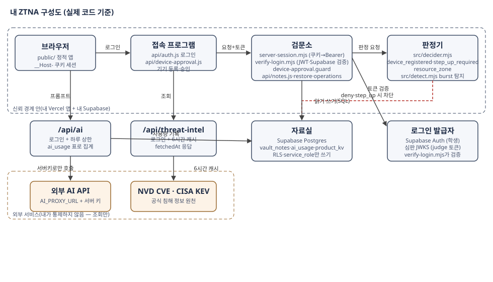

# 구성도와 신뢰 경계

실제 코드와 한 곳씩 대응합니다.

## 구성 요소 → 파일

| 구성도 상자 | 실제 파일 | 하는 일 |
|---|---|---|
| 브라우저 | `public/` | 정적 앱 화면. `__Host-` 쿠키 세션만 들고 다니고, 서버 키는 여기에 절대 안 옴 |
| 접속 프로그램 | `api/auth.js`, `api/device-approval.js` | Supabase 로그인 → 세션 쿠키 발급, 기기 등록·승인 |
| 검문소 | `src/server-session.mjs`(wrap), `src/verify-login.mjs`, `src/device-approval.mjs` | 쿠키를 Bearer로 변환, JWT·Supabase claims 검증, 기기 승인 통과 여부 |
| 판정기 | `src/decider.mjs`, `src/detect.mjs` | 규칙 `device_registered`·`step_up_required`·`resource_zone` 판정과 burst 탐지 |
| 자료실 | Supabase Postgres (`vault_notes`·`ai_usage`·`product_kv` 등) | RLS로 익명 차단, 쓰기는 service_role만 |
| `/api/ai` | `api/ai.js` | 로그인 필수 → `ai_usage` 표로 하루 상한 집계 → 서버 환경변수 키로만 외부 AI 호출 |
| `/api/threat-intel` | `api/threat-intel.js` | 로그인 필수 → CISA KEV·NVD 실조회 → 6시간 캐시 + `fetchedAt` |
| 외부 AI API / NVD·KEV | 신뢰 경계 밖 | 내가 통제하지 않는 서비스. 조회·중계만 하고 값을 신뢰해 권한을 주지 않음 |

## 신뢰 경계

- **경계 안**: 내 Vercel 앱 + 내 Supabase 프로젝트. 서버 환경변수(SECRET 키)는 Vercel 안에만 있고 브라우저로 나가지 않습니다.
- **경계 밖**: 외부 AI, NVD/KEV, 심판 서버. 심판의 JWT는 JWKS로 서명을 검증한 뒤에만 믿습니다(`verify-login.mjs`).
- 브라우저가 주장하는 역할·기기 상태는 믿지 않고, 서버가 저장한 값(기기 승인 표, 로그인 토큰)만 믿습니다.

## 요청 한 건의 흐름

1. 브라우저가 쿠키로 요청 → `server-session.mjs`가 서버 세션을 Bearer로 바꿈
2. `device-approval.guard`가 등록·승인 안 된 기기를 차단
3. 각 API가 `verify-login`으로 토큰을 검증(심판 JWT 또는 학생 Supabase 토큰)
4. 검문소·판정기를 통과한 요청만 자료실(SQL)에 닿고, 나머지는 401/403으로 거부
